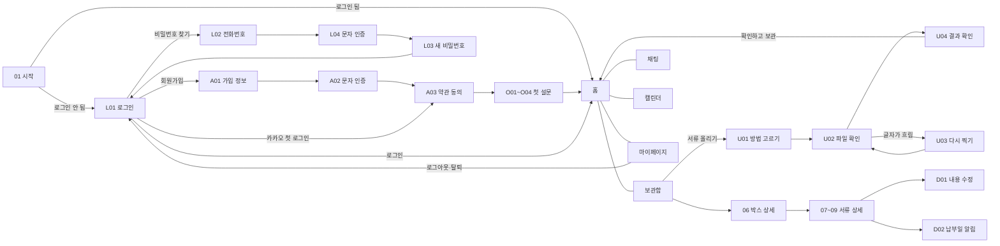

# 사용자 시나리오

이 문서는 차곡 앱을 사용자가 어떤 순서로 쓰는지 흐름별로 정리합니다.
화면을 새로 만들거나 고칠 때, 그리고 테스트 계정으로 앱을 점검할 때 기준으로 씁니다.

- 디자인 기준: Figma `가치` 파일의 화면 모음(node `3597-2`)
- 화면 번호(A01, U02 등)는 Figma 프레임 번호이고, 코드 주석·`*_strings.dart`에도 같은 번호를 씁니다.
- 경로는 `lib/app/router.dart`의 `AppRoute` 상수입니다.
- 화면이나 이동 경로가 바뀌면 이 문서도 같은 PR에서 고칩니다.

## 흐름 한눈에 보기

하단 탭은 왼쪽부터 **보관함 · 채팅 · 홈 · 캘린더 · 마이페이지**입니다. 앱을 열면 홈 탭이 먼저 보입니다.

## 목차

1. [앱 시작](#1-앱-시작)
2. [회원가입](#2-회원가입)
3. [로그인](#3-로그인)
4. [비밀번호 찾기](#4-비밀번호-찾기)
5. [첫 설문](#5-첫-설문)
6. [홈과 알림](#6-홈과-알림)
7. [서류 올리기](#7-서류-올리기)
8. [보관함과 서류 보기](#8-보관함과-서류-보기)
9. [서류 내용 수정·납부일 알림](#9-서류-내용-수정납부일-알림)
10. [캘린더](#10-캘린더)
11. [채팅으로 서류 물어보기](#11-채팅으로-서류-물어보기)
12. [설정](#12-설정)
13. [Figma와 다른 점](#figma와-다른-점)

---

## 1. 앱 시작

| 화면 | 이름 | 경로 |
|------|------|------|
| 01 | 시작(스플래시) | `AppRoute.splash` |

**시나리오** — 사용자가 앱 아이콘을 누른다.

1. 차곡 로고가 보이는 시작 화면이 뜬다.
2. 저장된 로그인 정보를 확인한다.
3. 결과에 따라 이동한다.
   - 로그인 정보가 있으면 → 원래 가려던 화면(없으면 홈)
   - 없으면 → L01 로그인

**분기·예외**

- 서버 주소(`API_BASE_URL`)가 비어 있으면 로그인 없이 바로 홈을 연다. (예시 데이터)
- 로그인한 상태에서 로그인 정보가 만료되고 재발급도 실패하면 어느 화면에서든 L01로 간다.

---

## 2. 회원가입

| 화면 | 이름 | 경로 |
|------|------|------|
| A01 | 처음 만나는 차곡 (가입 정보) | `AppRoute.signUp` |
| A02 | 문자를 확인해 주세요 (전화번호 인증) | `AppRoute.signUpVerification` |
| A03 | 시작 전, 확인해 주세요 (약관 동의) | `AppRoute.signUpTerms` |

**시나리오** — 처음 온 사용자가 전화번호로 가입한다.

1. L01에서 "아직 계정이 없나요? 회원가입"을 누른다.
2. A01에서 전화번호, 이름, 생년월일, 비밀번호, 비밀번호 확인을 입력하고 **인증번호 받기**를 누른다.
3. A02에서 문자로 받은 6자리를 입력하고 **인증하고 계속하기**를 누른다.
4. A03에서 필수 약관(서비스 이용약관, 개인정보 수집·이용)에 동의하고 **동의하고 가입 완료**를 누른다.
   마케팅 수신은 선택이다. 약관 오른쪽 **보기**를 누르면 본문이 시트로 뜬다. (정식 약관 전 예시 문구)
5. 가입이 끝나면 [첫 설문](#5-첫-설문) O01로 간다.

**분기·예외**

- 비밀번호가 규칙(8자 이상, 숫자·특수문자 포함)에 맞지 않거나 확인 값과 다르면 입력 칸 아래에 안내한다.
- 이미 가입한 전화번호면 "이미 가입한 전화번호예요."
- 인증번호가 틀리면 "인증번호가 맞지 않아요.", 시간이 지나면 "인증번호가 만료됐어요. 다시 받아 주세요."
- 인증번호 다시 받기는 기다리는 시간(초)이 지나야 누를 수 있다.
- A02·A03 주소로 바로 들어오면(앞 단계를 건너뛰면) A01로 돌려보낸다.
- A01의 "이미 계정이 있나요? 로그인"을 누르면 L01로 간다.

---

## 3. 로그인

| 화면 | 이름 | 경로 |
|------|------|------|
| L01 | 로그인 | `AppRoute.login` |
| A03 | 약관 동의 (간편 로그인 첫 사용) | `AppRoute.socialTerms` |

**시나리오 A — 전화번호 로그인**

1. L01에서 전화번호와 비밀번호를 입력한다. **자동 로그인**은 기본으로 켜져 있다.
2. **로그인**을 누르면 홈으로 간다.

**시나리오 B — 카카오 간편 로그인**

1. L01에서 **kakao 로그인**을 누른다.
2. 카카오 앱(또는 웹)에서 동의하고 차곡으로 돌아온다.
3. 서버 응답에 따라 이동한다.
   - 약관 동의가 필요하면 → A03(`socialTerms`) → O01 첫 설문 → 홈
   - 첫 설문이 필요하면 → O01 → 홈
   - 둘 다 끝났으면 → 홈

**분기·예외**

- 전화번호나 비밀번호가 틀리면 "전화번호 또는 비밀번호가 맞지 않아요."
- 자동 로그인을 끄면 로그인 정보를 기기에 저장하지 않아, 앱을 다시 열면 L01부터 시작한다.
- 같은 전화번호로 가입한 계정이 이미 있으면 "이 전화번호로 가입한 계정이 있어요. 전화번호로 로그인해 주세요."
- 카카오 서버와 연결하지 못하면 잠시 후 다시 시도하라고 안내한다.
- **Google 로그인**은 아직 연결하지 않아 "곧 지원할 예정이에요."만 보인다.

---

## 4. 비밀번호 찾기

| 화면 | 이름 | 경로 |
|------|------|------|
| L02 | 비밀번호를 잊으셨나요? | `AppRoute.forgotPassword` |
| L04 | 문자를 확인해 주세요 (전화번호 인증) | `AppRoute.passwordResetVerification` |
| L03 | 새 비밀번호 만들기 | `AppRoute.resetPassword` |

**시나리오** — 비밀번호를 잊은 사용자가 새 비밀번호를 만든다.

1. L01에서 **비밀번호 찾기**를 누른다.
2. L02에서 가입한 전화번호를 입력하고 **인증 코드 보내기**를 누른다.
3. L04에서 6자리 인증번호를 입력하고 **인증하고 계속하기**를 누른다.
4. L03에서 새 비밀번호를 두 번 입력하고 **비밀번호 변경**을 누른다.
5. "비밀번호를 바꿨어요. 새 비밀번호로 로그인해 주세요."가 보이고 L01로 간다.

**분기·예외**

- 가입하지 않은 전화번호면 "가입하지 않은 전화번호예요."
- 인증번호 오류·만료는 [회원가입](#2-회원가입)의 A02와 같다.
- L04·L03 주소로 바로 들어오면 L02로 돌려보낸다.

---

## 5. 첫 설문

| 화면 | 이름 | 경로 |
|------|------|------|
| O01 | 내국인이신가요? | `AppRoute.onboarding` |
| O02 | 어느 지역에 사시나요? | 〃 |
| O03 | 어떤 집에서 사시나요? | 〃 |
| O04 | 현재 받고계신 복지가 있나요? | 〃 |

**시나리오** — 가입을 마친 사용자가 상황에 맞는 서류 안내를 받기 위해 설문에 답한다.

1. O01에서 내국인 / 외국인 중 하나를 고르고 **다음**.
2. O02에서 사는 지역을 입력하면 맞는 시·도·시·군·구 후보가 아래에 뜬다. 후보를 누르거나 직접 입력하고 **다음**.
   후보는 주소 검색 API가 정해지기 전까지 앱에 넣어 둔 예시 목록이다.
3. O03에서 월세 / 전세 / 자가 / 기숙사·고시원 / 부모님 집 중 하나를 고르고 **다음**.
4. O04에서 기초생활수급 / 차상위계층 / 기타 / 해당 없음 중 고르고 **완료**.
5. 답을 저장하고 홈으로 간다.

**분기·예외**

- 위쪽 진행 막대로 4단계 중 몇 단계인지 보여 준다.
- 뒤로 가기를 누르면 앞 단계로 돌아간다. O01에서 뒤로 가면 이전 화면(없으면 홈)으로 간다.
- 저장에 실패하면 "답을 저장하지 못했어요. 다시 시도해 주세요."

---

## 6. 홈과 알림

| 화면 | 이름 | 경로 |
|------|------|------|
| — | 홈 | `AppRoute.home` |
| N01 | 알림 목록 | `AppRoute.notifications` |
| N02 | 알림 상세 | `AppRoute.notificationDetail(id)` |

**시나리오 A — 홈에서 오늘 챙길 일 보기**

1. 홈에서 **미니 캘린더**로 이번 주 기한과 가장 가까운 일정(D-day)을 본다.
2. **최근 연 보관함**에서 박스를 누르면 [박스 상세](#8-보관함과-서류-보기)로 간다.
3. **최근 알림**을 확인한다.
4. "2026년 11월 ›"를 누르면 캘린더 탭, "전체 보기 ›"를 누르면 보관함 탭으로 간다.

**시나리오 B — 납부 알림을 보고 완료 처리**

1. 홈(또는 보관함) 오른쪽 위 종 버튼을 누른다. 읽지 않은 알림이 있으면 점이 보인다.
2. N01에서 전체 / 읽지 않음 / 완료 탭으로 알림을 본다. **모두 읽음**으로 한 번에 읽음 처리할 수 있다.
3. 알림을 누르면 N02 상세가 바텀바 없이 열린다. 금액·납부일·연결 서류·안내가 보인다.
4. **납부 완료로 표시**를 누르면 "완료로 표시했어요."가 보이고 목록으로 돌아간다. 이 알림은 '완료' 탭으로 옮겨진다.
5. **연결된 서류 보기**를 누르면 그 서류 상세로 간다.

**분기·예외**

- 불러오기에 실패하면 안내와 **다시 시도** 버튼이 보인다.
- 일정·보관함·알림이 없으면 각각 빈 상태 문구("다가오는 일정이 없어요." 등)가 보인다.
- N01·N02의 알림 설정 버튼을 누르면 [S03 알림 설정](#12-설정)으로 간다.

---

## 7. 서류 올리기

| 화면 | 이름 | 경로 |
|------|------|------|
| U01 | 어떤 서류를 담을까요? (방법 고르기) | `AppRoute.upload` |
| U02 | 이 파일을 분석할까요? (파일 확인) | `AppRoute.uploadConfirm` |
| U03 | 조금 더 선명하게 찍어 주세요 (다시 찍기) | `AppRoute.uploadRetake` |
| U04 | 읽어 낸 내용을 확인해요 (결과 확인) | `AppRoute.uploadReview` |

**시나리오 A — 종이 서류를 찍어 보관하기 (기본)**

1. 보관함 탭(또는 박스 상세)의 **서류 올리기**(＋) 버튼을 누른다.
2. U01에서 **사진 촬영**을 고른다. 기기 문서 스캐너가 열린다.
3. 서류 네 모서리를 맞춰 찍고(여러 장 가능) 완료하면 U02로 간다.
4. U02에서 미리 보기와 쪽수를 확인하고 **보관할 곳**(박스)을 고른 뒤 **분석 시작**을 누른다.
5. 분석이 끝나면 U04에서 AI가 읽어 낸 조건(금액, 납부일, 계약 기간 등)을 확인한다.
6. **확인하고 보관**을 누르면 "서류를 보관함에 담았어요."가 보이고 홈으로 간다.
   서류에서 찾은 기한은 서류 상세·캘린더에서 볼 수 있다.

**시나리오 B — 앨범 사진 / PDF 올리기**

- U01에서 **앨범에서 선택** 또는 **PDF 파일 선택**을 고른다. 이후는 시나리오 A의 3단계부터 같다.
- PDF는 미리 보기 대신 "PDF 내용은 분석하면서 읽어요."가 보인다.

**시나리오 C — 글자가 흐려서 다시 찍기**

1. U02에서 분석을 시작했는데 글자를 정확히 읽지 못하면 U03으로 간다.
2. U03에서 "일부 글자가 흐릿해요" 안내와 촬영 요령(밝은 곳, 평평하게, 카메라 고정)을 본다.
3. **다시 촬영하기** 또는 **다른 이미지 선택**으로 새로 고르면 U02로 돌아간다.

**시나리오 D — 읽은 내용이 틀려서 고치기**

1. U04에서 "확인 필요" 표시가 붙은 조건(예: 중도 해지 위약금)을 본다.
2. **내용 수정하기**를 누르면 [D01 서류 내용 수정](#9-서류-내용-수정납부일-알림)으로 간다.

**분기·예외**

- 카메라 권한이 꺼져 있으면 U01에 안내와 **설정 열기** 버튼이 보인다.
- 암호가 걸린 PDF는 암호를 해제한 뒤 다시 올리라고 안내한다.
- 원본과 이름이 다른 조건은 "원본의 ‘월세’를 ‘월 임대료’로 정리했어요."처럼 알려 준다.
- 처리에 실패하면 "처리하지 못했어요. 잠시 후 다시 시도해 주세요."
- 앱을 다시 열어 고른 파일이 사라졌을 때 U02·U04 주소로 들어오면 U01로 돌려보낸다.

---

## 8. 보관함과 서류 보기

| 화면 | 이름 | 경로 |
|------|------|------|
| — | 내 보관함 | `AppRoute.archive` |
| 05 | 새 박스 만들기 (시트) | 보관함 위에 뜸 |
| 06 | 박스 상세 | `AppRoute.archiveBox(id)` |
| — | 서류 검색 | `AppRoute.archiveSearch` |
| 07~09 | 서류 상세 (원본 / AI 정리본) | `AppRoute.document(id)` |

**시나리오 A — 박스를 만들어 서류 정리하기**

1. 보관함 탭에서 마지막 칸 **새 박스**를 누른다.
2. 05 시트에서 박스 이름, 색(살구·연두·회색), 아이콘을 고르고 **만들기**를 누른다.
3. 새 박스가 목록에 추가된다.

**시나리오 B — 박스에서 서류 찾아 보기**

1. 보관함 탭에서 박스(예: 집 · 임대)를 누르면 06 박스 상세로 간다.
2. 서류 카드에서 쪽수, 중요도, D-day를 본다.
3. 카드를 누르면 07 서류 상세의 **원본** 탭이, 초록 **AI 정리본 보기** 버튼을 누르면 **AI 정리본** 탭이 열린다.
   원본 탭은 원본 이미지를 받기 전까지 서류 이름과 읽어 낸 항목을 적은 예시 종이를 보여 준다.
4. AI 정리본 탭에서 한 줄 요약, 중요도, 비용, D-day와 기한을 본다.
   서버가 특약·체크 목록을 주기 전까지 서류 종류별 예시 "주요 특약 (예시)"·"체크"가 붙는다.
   "기한 자동 등록됨"이면 캘린더에 이미 들어가 있다.
5. 위쪽 **더보기**에서 내용 수정 / 납부일 알림을 고른다. → [9장](#9-서류-내용-수정납부일-알림)

**시나리오 C — 이름이나 내용으로 서류 검색**

1. 보관함 탭의 "서류 이름·내용 검색" 칸을 누른다.
2. 검색어(예: 관리비)를 입력하면 맞는 서류가 보인다.
3. 결과를 누르면 서류 상세로 간다.

**분기·예외**

- 박스에 서류가 없으면 "아직 담긴 서류가 없어요."
- 검색 결과가 없으면 "‘관리비’에 맞는 서류가 없어요."
- 박스 만들기에 실패하면 "박스를 만들지 못했어요. 다시 시도해 주세요."
- 지워졌거나 없는 서류·박스를 열면 "서류를 찾을 수 없어요." / "보관함을 찾을 수 없어요."

---

## 9. 서류 내용 수정·납부일 알림

| 화면 | 이름 | 경로 |
|------|------|------|
| D01 | 서류 내용 수정 | `AppRoute.documentEdit(id)` |
| D02 | 납부일을 알려 드릴게요 | `AppRoute.paymentReminder(id)` |

**시나리오 A — AI가 잘못 읽은 값 고치기**

1. 서류 상세의 **더보기 → 내용 수정**(또는 U04의 **내용 수정하기**)을 누른다.
2. D01에서 문서 종류, 월 임대료, 납부일, 계약 종료일, 중도 해지 위약금을 고친다.
3. **수정 내용 저장**을 누르면 "수정한 내용을 저장했어요."가 보이고 이전 화면으로 돌아간다.
   고친 값은 AI 정리본과 비교 결과에 반영된다.
4. 원본과 비교하고 싶으면 **원본 확인하기**를 누른다. 서류 상세의 원본 탭으로 돌아간다.

**시나리오 B — 매달 납부일 알림 받기**

1. 서류 상세의 **더보기 → 납부일 알림**을 누른다.
2. D02에서 월 임대료와 납부일(매월 N일)을 확인한다.
3. 알림 시간, 미리 알림(당일 / 1일 전 / 3일 전 / 7일 전, 처음엔 당일·1일 전), 매월 반복을 정한다.
4. **알림 등록하기**를 누르면 "납부일 알림을 등록했어요."

**분기·예외**

- 월 임대료에 숫자가 아닌 글자를 넣으면 "숫자만 입력해 주세요."
- 미리 알림을 하나도 고르지 않으면 "미리 알림을 하나 이상 골라 주세요."
- 기기 알림이 꺼져 있으면 알림을 받을 수 없다고 안내한다.
- 저장·등록에 실패하면 잠시 후 다시 시도하라고 안내한다.

---

## 10. 캘린더

| 화면 | 이름 | 경로 |
|------|------|------|
| — | 캘린더 (월 보기 / 날짜 고르기) | `AppRoute.calendar` |

**시나리오 A — 이번 달 기한 훑어보기**

1. 캘린더 탭을 누른다.
2. 달력에서 기한이 있는 날을 본다. 색으로 **기한 자동 등록됨**과 **미추가 기한**을 구분한다.
3. 아래 **다가오는 기한** 목록에서 D-day 순으로 본다.
4. 이전 달 / 다음 달 버튼이나 연·월 고르기로 다른 달로 옮긴다.

**시나리오 B — 날짜를 골라 기한 추가·빼기**

1. 달력에서 날짜를 누르면 목록이 "11월 25일" 같은 그날의 기한으로 바뀐다.
2. 기한 오른쪽 버튼으로 캘린더에 추가하거나 뺀다.
3. 같은 날짜를 다시 누르거나 **전체 보기**를 누르면 다가오는 기한 전체로 돌아간다.

**분기·예외**

- 그날 기한이 없으면 "이날은 기한이 없어요."
- 추가·빼기에 실패하면 "캘린더에 반영하지 못했어요. 다시 시도해 주세요."
- 지난 기한은 D+N으로 보인다.

---

## 11. 채팅으로 서류 물어보기

| 화면 | 이름 | 경로 |
|------|------|------|
| H03 | 채팅 목록 | `AppRoute.chat` |
| H01 | 서류에 대해 물어보세요 (대화) | `AppRoute.chatRoom(id)` |
| H02 | 대화에 서류 추가 | `AppRoute.chatAttach(id)` |

**시나리오 A — 새 대화로 계약서 내용 묻기**

1. 채팅 탭의 H03에서 **새 대화 시작**을 누른다.
2. H01 대화방이 열린다. 아직 서류가 없으면 위쪽 띠에 "연결된 서류가 없어요 변경 ›"이 보인다.
3. 띠의 **변경 ›** 또는 입력줄 왼쪽 서류 추가 버튼을 누른다.
4. H02에서 **내 보관함에서 선택**으로 서류를 고르고 **이 서류로 대화하기**를 누른다.
5. H01로 돌아와 "월세는 언제 내야 하나요?"처럼 질문을 보낸다.
6. 답과 함께 **근거**(서류의 어느 부분인지)가 보이고, **원본 확인 ›**을 누르면 서류 상세로 간다.

**시나리오 B — 지난 대화 이어 가기**

1. H03에서 오늘 / 이전 대화 목록을 보거나 "대화 내용 검색"으로 찾는다.
2. 대화를 누르면 H01에서 이어서 묻는다.

**분기·예외**

- 서류 없이 질문을 보내면 "물어볼 서류가 없어요. 대화에 서류를 먼저 추가해 주세요."
- 보관한 서류가 하나도 없으면 H02에서 보관함에 먼저 올리라고 안내한다.
  외부 파일은 채팅에서 바로 올리지 않고 보관함 → 박스에 올린 뒤 고른다.
- 답을 받지 못하면 "답을 받지 못했어요." 와 **다시 보내기**가 보인다.
- 답을 기다리는 동안 "답을 찾고 있어요…"가 보인다.

---

## 12. 설정

| 화면 | 이름 | 경로 |
|------|------|------|
| S01 | 설정 | `AppRoute.settings` |
| S02 | 글자 크기 | `AppRoute.textSizeSettings` |
| S03 | 놓치지 않도록 알려 드려요 (알림 설정) | `AppRoute.notificationSettings` |
| S04 | 로그아웃 확인 창 | S01 위에 뜸 |
| S05 | 탈퇴 확인 창 | S01 위에 뜸 |

**시나리오 A — 글자를 크게 바꾸기**

1. 마이페이지 탭의 S01에서 **글자 크기**를 누른다.
2. S02에서 보통 / 크게 / 아주 크게 중 고르고 미리 보기로 확인한다.
3. **이 크기로 저장**을 누르면 앱 전체 글자 크기가 바뀐다.

**시나리오 B — 납부일 알림 켜기**

1. S01에서 **알림 설정**을 누른다.
2. S03에서 납부일 알림, 마케팅 수신을 켜고 끄며, 기본 알림 시각을 정한다.
3. 기기 알림이 꺼져 있으면 **기기 알림 켜기**(기기 설정 열기)를 누르거나 **나중에 할게요**를 누른다.

**시나리오 C — 로그아웃 / 회원 탈퇴**

1. S01의 **로그아웃**을 누르면 S04 "로그아웃하시겠어요?" 창이 뜬다. **예**를 누르면 L01로 간다.
2. **회원 탈퇴**를 누르면 S05 "정말 탈퇴하시겠어요?" 창이 뜬다.
   보관한 서류와 기록이 모두 삭제되고 복구할 수 없다고 안내한다. **탈퇴**를 누르면 L01로 간다.

**분기·예외**

- 기기 권한을 바꿔도 등록한 납부 일정은 사라지지 않는다.
- 로그아웃·탈퇴·저장에 실패하면 다시 시도하라고 안내한다.
- 앱 버전을 읽지 못하면 값 자리에 `-`를 보인다.

---

## Figma와 다른 점

Figma 화면 중 앱에서 다르게 만든 부분입니다. 디자인과 맞출지 정해지면 이 목록을 고칩니다.

| Figma | 앱 | 이유 |
|-------|-----|------|
| 앱 안 카메라 촬영 화면, 앨범 여러 장 고르기 시트 | 기기 문서 스캐너(`cunning_document_scanner`)를 엶 | 모서리 인식·보정을 기기 스캐너에 맡김 |
| "AI가 서류를 정리하고 있어요" 분석 진행 화면 | U02의 **분석 시작** 버튼이 "분석하고 있어요…"로 바뀜 | 확인 필요 |
| 서류 검색 화면의 필터 칩 | 검색어 입력만 있음 | 확인 필요 |
| Google 로그인 | "곧 지원할 예정이에요." 안내만 | SDK 연결 전 |
| O02 도로명주소 검색 | 앱에 넣은 시·도·시·군·구 예시 목록에서 후보를 보여 줌 | 주소 검색 API 전 |
| 07 원본 이미지 | 서류 이름·항목을 적은 예시 종이 | 서버 원본 파일 전 |
| AI 정리본 특약·체크 | 서류 종류별 예시 목록 | 서버 응답에 없음 |
| A03 약관 상세 | 예시 약관 문구 시트 | 정식 약관 전 |
| 시작 화면의 "서류를 간단하게, 차곡" 문구 | 로고만 보임 | 확인 필요 |
